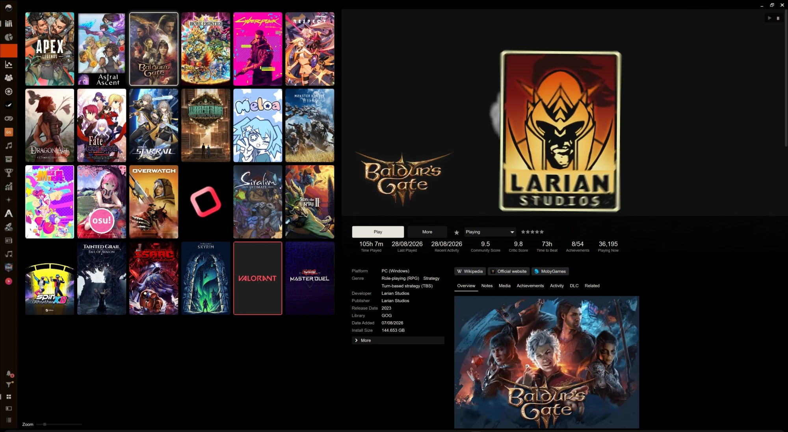
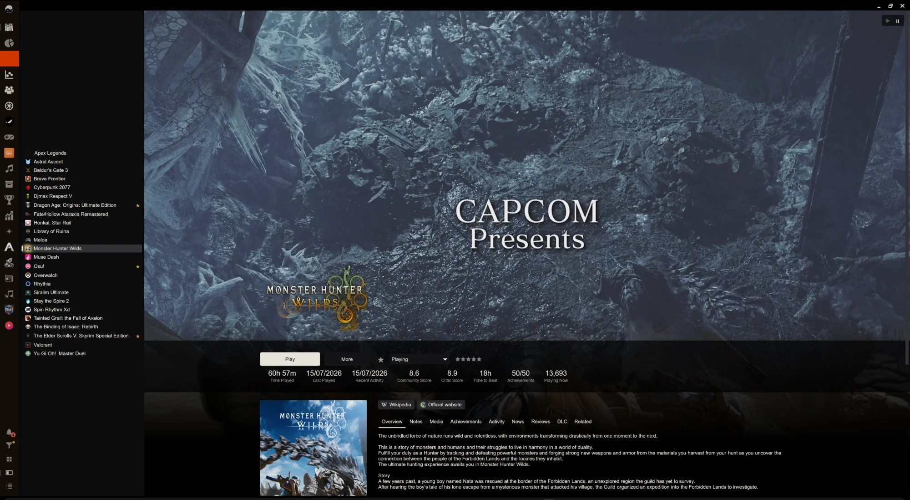

# Laylu

[](https://github.com/Kyerstorm/Playnite-Laylu-Theme/releases)
[](https://github.com/Kyerstorm/Playnite-Laylu-Theme/releases/latest)
[](https://github.com/Kyerstorm/Playnite-Laylu-Theme/commits/main)
[](LICENSE)

> [!NOTE]
> **AI disclaimer:** I built this theme while learning XAML (WPF). AI assistance was used only to verify files/external plugin support and to help develop ideas.

A dark, cinematic Desktop theme for [Playnite](https://playnite.link). Covers on a black grid, a slim sidebar, a top bar that stays out of the way, and a details page with the trailer as its background.

- Playnite 10, Desktop mode, Theme API 2.10.0
- English only
- Designed at 4K (3840x2160), 150% scaling

[](screenshots/grid.jpg)

[](screenshots/details.jpg)

## Install

1. Download the `.pthm` file from the [latest release](https://github.com/Kyerstorm/Playnite-Laylu-Theme/releases/latest).
2. Open it (double-click), or drag it onto the Playnite window.
3. In Playnite: Settings → Appearance → General → Theme → **Laylu**, then restart Playnite.

The theme works with no extensions installed. Everything that depends on an extension is simply absent without it.

## What it looks like

- **Sidebar**: a 56-unit rail. Extension items at the top; notifications, filter, and the Grid / Details / List switch at the bottom. While a filter is active the filter button carries a dot and a "clear filters" button appears under it.
- **Top bar**: hidden until the pointer reaches the top edge, or pinned. The library moves down while it is open.
- **Grid view**: covers only, rounded, with a glow on the hovered, selected and running game, and a play button on hover. A details panel sits beside the grid.
- **Details view**: a game list on the left and a full page on the right: trailer or artwork at the top, a strip with Play and the stats, then cover, fields, links and tabs.

## Extensions

All optional. Each part appears only when its extension is installed and has something for the selected game.

| Extension | Adds |
|---|---|
| ThemeModifier | The settings below |
| Extra Metadata Loader | Trailer as the details page background; game logo as the title |
| ThemeExtras | Favourite, completion status and rating on the page; site icons on links |
| HowLongToBeat | "Time to Beat" in the stats strip; progress bar in the Activity tab |
| Playnite Achievements | Unlocked / total in the stats strip; Achievements tab |
| GameActivity | Play-time chart in the Activity tab |
| Screenshot Utilities | Media tab |
| News Viewer | News tab |
| Universal Steam Player Count | "Playing Now" in the stats strip |
| Review Viewer | Reviews tab |
| CheckDlc | DLC tab |
| Game Relations | Related tab |
| PlayNotes | Notes, in the Notes tab |
| PokeTeams | Your Pokémon team for the game, under the description |
| ImageRotater | Rotating covers on the grid and the details page; rotating background on the game page |

The height of the article in the News tab is set in News Viewer's own settings ("Maximum height of news notes").

## Settings

Install the ThemeModifier extension to change these. Without it, the defaults apply.

| Group | Setting | Default |
|---|---|---|
| Colours | Accent | `#E8E4DC` |
| Colours | Text | `#E8E4DC` |
| Colours | Text, muted | `#9A968E` |
| Colours | Surface, raised (inputs and buttons) | `#141416` |
| Colours | Surface, panels (sidebar and top bar) | `#0B0B0C` |
| General | Performance mode: no glow, no rounded covers, no trailer background | off |
| General | Reduce motion: the top bar appears without sliding, and the title strip dims without fading during the trailer | off |
| General | Hide the top bar until the pointer reaches the top edge | on |
| Grid | Rounded cover corners | on |
| Grid | Play button on the hovered cover | on |
| Grid | Glow around the hovered, selected and running cover | on |
| Grid | Star on favourite covers | off |
| Details | Use the game logo as the title when one exists | on |
| Details | Dim the title strip and logo while the trailer plays | on |

Reduce motion covers the theme's own animations. Three kinds of movement belong to something else: the crossfade between background images (Playnite: Settings → Appearance → "Animate background image transitions"), the slide of the notification panel (Playnite's own, a tenth of a second), and trailers and rotating covers (the settings of Extra Metadata Loader and ImageRotater).

Three things follow Playnite's own settings instead of a theme setting: names under covers, dimming of games that are not installed, and the width of the details panel and game list.

## Palette

| Role | Colour |
|---|---|
| Base (window, grid) | `#000000` |
| Surface 1 (sidebar, top bar, panels) | `#0B0B0C` |
| Surface 2 (inputs, buttons, missing covers) | `#141416` |
| Surface 3 (menus, popups) | `#1D1D20` |
| Hover | `#26262A` |
| Selected | `#323237` |
| Text and accent | `#E8E4DC` |
| Text, muted | `#9A968E` |
| Positive | `#5FB37A` |
| Mixed, favourite star | `#D9A441` |
| Negative, warning | `#D9655B` |

### Accent presets

Laylu has no hue of its own by default: the accent is the text colour. For a coloured accent, set **Colours → Accent** in ThemeModifier to one of these, or to any colour you like.

| Preset | Accent |
|---|---|
| Default | `#E8E4DC` |
| Ember | `#E0A040` |
| Aurora | `#3CC8C0` |
| Orchid | `#B48CF0` |

The accent colours the icons, the bar beside the selected sidebar item, the Play button and the glow around covers. Text keeps its own colour. Links inside a game's description stay the default colour, and so does the glow if the accent is set to a gradient.

## Notes for slower machines

Turn on **Performance mode**. Rounded covers and the glow are the two costly effects on a large library; the trailer background is the costly one on the details page.

## Building the package

```
powershell -ExecutionPolicy Bypass -File tools\pack.ps1
```

This runs the checks below, then packs the theme with Playnite's Toolbox into `dist`. It expects `C:\Games\Playnite\Toolbox.exe`; pass `-Toolbox` or set `PLAYNITE_TOOLBOX` for another location.

The script gives Toolbox a full path, which matters: Toolbox removes its folder argument from every file name, so a relative `theme` also turns `thememodifier.yaml` into `modifier.yaml` and ThemeModifier stops finding the settings. Only files tracked by git are packaged.

Toolbox leaves out every file that is identical to Playnite's default theme, so the package holds only what Laylu changes.

## Working on the theme

- `theme/Views/GridViewGameOverview.xaml` is generated. Edit `DetailsViewGameOverview.xaml`, then run `tools\sync-grid-page.ps1`.
- `tools\check.ps1` checks that every XAML file is well-formed, that the generated page is up to date, and that the version agrees across `theme.yaml`, `installer.yaml` and `CHANGELOG.md`. It also runs on every push.
- `tools\test-motion.ps1` replays the top bar and the trailer fade outside Playnite, with Reduce motion switched at every awkward moment. Run it after touching either: `powershell -STA -ExecutionPolicy Bypass -File tools\test-motion.ps1`.
- For a release, change the version in those three files together.
- [docs/specification.md](docs/specification.md) and [docs/discovery.md](docs/discovery.md) are the original design and its decision history. Changes per release are in [CHANGELOG.md](CHANGELOG.md).

## Licence

MIT. See [LICENSE](LICENSE).
